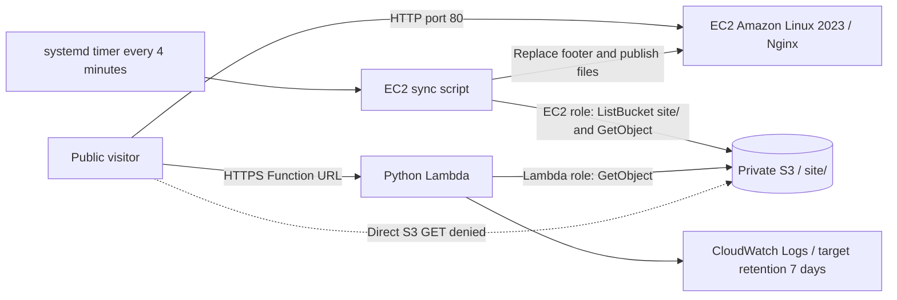

# Lab 7 — Host Your CV on AWS

Muhammad Arslan · **23L-3025** · iqbalarslan009@gmail.com

This project hosts my CV through an EC2 web server and a Python Lambda Function URL, with a private S3 bucket as the shared source. The portfolio HTML, responsive CSS and original CV PDF are preserved.

| Resource | Address or name |
| --- | --- |
| Repository | https://github.com/m-arslan009/Lab-7-CV-AWS-Hosting |
| EC2 website | http://54.252.152.179 |
| Lambda website | https://mxih5vg6yivpvbekwwnzgiyo7y0vhdqv.lambda-url.ap-southeast-2.on.aws/ |
| Region | `ap-southeast-2` (Sydney) |
| S3 bucket | `cv-23l-3025-82741` |
| EC2 instance Name tag | `cv-ec2-23l-3025` |
| EC2 role | `cv-ec2-role-23l-3025` |
| Lambda function | `cv-func-23l-3025` |
| Lambda role | `cv-lambda-role-23l-3025` |

## Verification status

Authenticated AWS evidence from the supplied `aws-lab7-evidence.zip` was collected in CloudShell on **24 October 2026 at 18:30 UTC (23:30 Asia/Karachi)**, with IAM exports at 18:31 UTC. It has replaced the earlier missing-CLI output in `evidence.txt`. The evidence contains all eleven required sections and reports zero unexpected command/discovery errors; the expected `NoSuchBucketPolicy` response confirms there is no bucket policy. Command success is separate from assignment compliance: the IAM resource pattern and tag-case issues below remain unresolved.

Archive SHA-256: `9d297a66b7b6715f5cb8aaeef5942fcf03e6bc982550fd8679e02c0258b89881`. The six imported files are preserved byte for byte from the archive. `iam/deployed-policy-metadata.json` records the caller, real policy names, managed attachments and review findings. These are actual exported policies, not proposed replacements. No AWS resource was changed during integration.

| Check | Actual evidence | Result |
| --- | --- | --- |
| Caller and Region | Account `240571106211`, assumed `AccountFullAccessRole`, bucket Region `ap-southeast-2` | Verified snapshot |
| Private S3 | Four Block Public Access flags true; no bucket policy; owner-only FULL_CONTROL ACL; BucketOwnerEnforced | Pass |
| Versioning | `Enabled` | Pass |
| Current S3 objects | Exactly `site/index.html` (13,074 bytes), `site/style.css` (14,307), `site/cv.pdf` (104,015); no folder marker or other current object | Pass |
| EC2 role | EC2 service trust; GetObject on `site/*`; ListBucket with exact `site/` condition; no attached managed policies | Scope limited; strict wildcard constraint unresolved |
| Lambda role | Lambda service trust; GetObject on `site/*`; no ListBucket; AWSLambdaBasicExecutionRole attached | Scope limited; strict wildcard constraint unresolved |
| Security group | `sg-073380e3f053b64a3`: TCP 80 from `0.0.0.0/0`, TCP 22 from `103.157.248.25/32`, no other inbound rules | Pass for rule shape; ownership of SSH source address not independently verified |
| EC2 | Running `t3.micro`, Amazon Linux 2023 AMI `ami-0ddbd63d0e3325a92`, IMDSv2 required, expected role/profile | Pass for recorded configuration |
| HTTP paths | Both hosts return 200 for HTML/CSS/PDF with correct types; Lambda `/anything` returns HTML 404; direct S3 returns 403 | Pass |
| Lambda | `python3.14`, 128 MB, 10-second timeout, expected BUCKET/PREFIX/role, Function URL AuthType NONE | Pass for recorded configuration |
| Logging | 45 observed application JSON records contain fn/path/status/ms; log group retention is 7 days | Pass for observed records and retention |
| Required tags | Bucket, instance, function and both roles have `Course=cloud`, `Owner=23l-3025` | Present; case differs from handout's `23L-3025` roll number |
| Budget and hygiene | COST budget `cv-lab7-budget`, USD 5 limit; one nonterminated instance; no Elastic IP, active/pending NAT gateway or classic/v2 load balancer in Sydney | Verified snapshot; budget period/alerts and other Regions not collected |
| EC2 timer and log excerpt | No deployed timer output or last-ten-log excerpt in archive | Pending |
| EC2 instance-role denial | No real failed write/delete output in archive | Pending |

Public HTTP checks refreshed on **25 October 2026 at 09:34 Asia/Karachi** passed all ten tests in `endpoint-checks.txt`. The EC2 footer read `Hosted on: EC2 i-0dd412efb83c5229b`; authenticated instance evidence now confirms that same instance ID and public IP. Lambda's footer was `Hosted on: Lambda cv-func-23l-3025`, with `Cache-Control: max-age=60`. Both downloaded PDFs matched the original PDF byte for byte in `endpoint-checks.txt`. The historical CloudShell endpoint section corroborates the earlier response statuses and MIME types.

Local Python, Bash, JSON, structure, file-size and secret/private-key checks passed. The original portfolio, CSS and PDF are unchanged. Reviewed repository EC2 scripts and Lambda source have not been deployed by this integration task; the archive does not contain a byte-for-byte export of deployed code or EC2 user data. The running synchronization interval remains unverified until the actual timer and logs are collected.

### Latest user-reported changes and evidence still needed

On **25 October 2026**, the student reported replacing both deployed GetObject resource patterns with the three explicit object ARNs, successful PowerShell SSH access, and multiple consecutive synchronization SUCCESS entries. No newer archive or captured instance output was available for this review. Local AWS CLI is absent and no SSH agent is running; the private PEM file was not opened or used. These deployment updates remain **user-reported, pending fresh exports/output**. The existing authenticated snapshot and IAM JSON are preserved, including their older `site/*` values; they must not be presented as current confirmation of the reported fixes.

The budget's USD 5 limit is verified by the existing snapshot; its monthly period is user-reported until the refreshed collector includes `Period:TimeUnit`. The helper's treatment of outputs was reviewed: it checks authentication first, backs up existing evidence under ignored `.validation/backups/`, replaces `evidence.txt` with actual collection output, then retrieves/parses all IAM documents before replacing local exports. It also writes real source metadata and reports policy findings without changing AWS. Do not run it in an unauthenticated local shell expecting a successful refresh.

## Architecture



An EC2 request reaches Nginx on port 80, which serves a local copy refreshed from private S3 using the instance role. A Lambda request reaches the public Function URL, whose handler retrieves the selected S3 object using the function role and builds the HTTP response.

## Repository

```text
README.md
collect-evidence.sh
evidence.txt
site/
  index.html
  style.css
  cv.pdf
ec2/
  user-data.sh
  sync-cv.sh
lambda/
  lambda_function.py
iam/
  ec2-trust.json
  ec2-permissions.json
  lambda-trust.json
  lambda-permissions.json
```

`collect-cloudshell.sh` performs authenticated collection and local IAM exports; `ec2/collect-instance-evidence.sh` collects timer/log/role-denial proof on the instance. `endpoint-checks.txt` contains the fresh real public HTTP results. `.gitignore` protects local credentials, private keys and generated packages; `.gitattributes` keeps shell scripts in LF format. The supplied assignment document is retained locally as a reference, outside the submission commit.

Technologies: Amazon S3, EC2, IAM, Lambda Function URLs, CloudWatch Logs, Amazon Linux 2023, Nginx, systemd, AWS CLI, Python/boto3, Bash, HTML/CSS, Git and curl.

## S3 and IAM

The authenticated snapshot shows all four S3 Block Public Access settings enabled, versioning Enabled, no bucket policy, owner-only ACL access and BucketOwnerEnforced object ownership. The bucket contains exactly three current objects and no `site/` folder marker: `site/index.html`, `site/style.css`, `site/cv.pdf`. HTML and PDF sizes are below the assignment limits. Historical versions may exist because versioning is enabled; the collector enumerates current objects.

The four policy files in `iam/` now contain actual exports. EC2 trusts `ec2.amazonaws.com` and uses inline policy `cv-ec2-s3-policy-23l-3025`; Lambda trusts `lambda.amazonaws.com` and uses inline policy `cv-lambda-s3-policy-23l-3025`. EC2 has no attached managed policies. Lambda has the verified AWS managed policy `arn:aws:iam::aws:policy/service-role/AWSLambdaBasicExecutionRole` plus its S3 inline policy, and no ListBucket permission.

Both actual S3 permission documents contain this exact GetObject resource:

```json
{"Effect":"Allow","Action":"s3:GetObject","Resource":"arn:aws:s3:::cv-23l-3025-82741/site/*"}
```

EC2 additionally has `s3:ListBucket` on `arn:aws:s3:::cv-23l-3025-82741`, conditioned on `StringEquals: {"s3:prefix": "site/"}`. Neither inline policy grants S3 writes/deletes or wildcard actions. `site/*` matches objects only within the named bucket's `site/` prefix; it is not the unrestricted resource `"*"`. This is a valid prefix-scoped AWS resource pattern, as explained in [AWS IAM resource documentation](https://docs.aws.amazon.com/IAM/latest/UserGuide/reference_policies_elements_resource.html).

**Historical assignment discrepancy:** Section 4 explicitly says no wildcard resources except in the managed logging policy. Both inline policies in the 24 October export contain `site/*`; the student now reports replacing these in AWS with the three explicit object ARNs. Current compliance is pending fresh exports, rather than a confirmed continuing deployment defect. The historical metadata's four findings reflect the older pattern and the earlier validator's expectation of three explicit object ARNs; they do not mean the roles had unrestricted account-wide access. No exported policy or metadata finding was silently changed. Refresh actual evidence before considering any further IAM change; do not repeat a reported completed fix based on the historical JSON.

Use `bash collect-cloudshell.sh` for a future authenticated refresh. It discovers actual inline policy names, retrieves/parses all four documents before replacing local files, preserves local backups under ignored `.validation/backups/`, and records source metadata. Multiple inline policies or retrieval failures stop the four-file replacement for review. The helper reports discrepancies without modifying AWS permissions. The public Function URL's wildcard Principal is an invocation permission, separate from S3 execution-role resource scope; AWSLambdaBasicExecutionRole's logging wildcard is the handout's explicit exception.

## EC2 implementation and setup

`ec2/user-data.sh` is intended for a new Amazon Linux 2023 instance. It checks the operating system, installs Nginx, AWS CLI, Python and locking utilities, embeds the exact standalone sync script in `/opt/cv/sync-cv.sh`, and creates a systemd service and timer. It starts Nginx, enables the timer and starts the initial sync. The existing instance's user data has not been replaced.

The sync script uses temporary credentials supplied by the IAM instance role. It downloads `site/` into a temporary staging directory, retrieves the real instance ID through an IMDSv2 token, validates all three files, and replaces the placeholder with `EC2 <instance-id>`. Each file is published with an atomic rename after downloads succeed; HTML is published last. Staging afresh also prevents a previously substituted footer from defeating later synchronization. The script writes a UTC timestamp and `SUCCESS` or `FAILED` to `/var/log/cv-sync.log` and uses a lock to prevent concurrent runs.

The timer starts the service every four minutes; the service has a 50-second timeout, leaving headroom within the five-minute update requirement during successful operation. Network or permission failures can delay updates and are recorded as failures; the next timer run retries. Nginx's standard MIME configuration serves HTML, CSS and PDF.

For a reviewed future deployment, use one eligible `t2.micro` or `t3.micro` Amazon Linux 2023 instance, attach the instance profile containing the EC2 role, require IMDSv2 (`HttpTokens=required`), and use its ordinary public IPv4 address. Permit inbound TCP 80 from anywhere; TCP 22 must be absent or restricted to your own single `/32`; allow no other inbound rules. Do not allocate an Elastic IP, NAT gateway or load balancer. For literal handout compliance, use `Owner=23L-3025` and `Course=cloud` on the instance, bucket, function and both roles; the actual imported Owner values are lowercase and remain unchanged pending review. Check your account's actual Free Tier/credits and budget in Billing.

Read-only checks from a shell on the existing instance:

```bash
cat /etc/os-release
systemctl status nginx cv-sync.timer --no-pager
systemctl cat cv-sync.service cv-sync.timer
sudo tail -n 10 /var/log/cv-sync.log
```

## Lambda implementation and setup

The local handler is `lambda_function.lambda_handler` and reads `BUCKET` and `PREFIX` from the environment. Authenticated function configuration confirms `BUCKET=cv-23l-3025-82741`, `PREFIX=site/`, runtime `python3.14`, memory 128 MB, timeout 10 seconds and execution role `cv-lambda-role-23l-3025`. The CloudWatch log group `/aws/lambda/cv-func-23l-3025` has verified seven-day retention. The collector does not export the deployed handler setting or source ZIP, so local-source equivalence and the handout's latest-offered-runtime wording are not independently certified.

`/` and `/index.html` return HTML with the footer `Hosted on: Lambda cv-func-23l-3025` and `Cache-Control: max-age=60`. `/style.css` returns CSS; `/cv.pdf` returns a base64 body with `isBase64Encoded=true` and `Content-Type: application/pdf`. Unknown paths return a short HTML page with status 404 without accessing S3. Internal retrieval failures return a generic error; known missing objects return 404, but S3 can conceal a missing object as AccessDenied when the role lacks ListBucket. Each handled request prints one JSON record with `fn`, `path`, `status` and elapsed `ms`; Lambda platform lifecycle logs are separate.

The exported Function URL configuration confirms authentication `NONE`. The actual resource policy grants public `lambda:InvokeFunctionUrl` with `lambda:FunctionUrlAuthType=NONE`, and public `lambda:InvokeFunction` with `lambda:InvokedViaFunctionUrl=true`, both on this specific function ARN. These invocation permissions are distinct from the execution role's private S3 access. No function code, environment, URL policy or log group was modified here.

For a future approved code deployment, package `lambda/lambda_function.py` at the root of the ZIP, choose the handler above, review the current configuration, and deploy through your existing Lambda function. Preserve the known working deployment until its configuration and source have been exported and compared. Likewise, review S3 changes before uploading: the EC2 timer automatically publishes them.

## Testing and evidence collection

Run this from a Bash shell with AWS CLI and curl available, preferably AWS CloudShell in Sydney or an approved authenticated CLI session. Use temporary/session credentials with the required read permissions; never put credentials in this repository.

```bash
bash collect-evidence.sh cv-23l-3025-82741 \
  http://54.252.152.179 \
  https://mxih5vg6yivpvbekwwnzgiyo7y0vhdqv.lambda-url.ap-southeast-2.on.aws/
```

With AWS CLI and curl available, the collector writes `evidence.txt`, records command failures, continues through exactly 11 named sections, and prints `DONE`. If AWS CLI or curl is absent, it exits 127 before touching existing evidence and gives CloudShell instructions. Authentication or individual AWS command failures are recorded during collection; `DONE` means collection finished, not that AWS configuration passed. `NoSuchBucketPolicy` is explicitly marked expected; AccessDenied and other errors remain unexpected. Account-dependent checks are skipped if account discovery fails, and Lambda tags use the actual function ARN rather than a constructed account placeholder. With two arguments it prints usage and exits 1. The root `evidence.txt` now contains the imported authenticated run; re-run only for a deliberate refresh and review the resulting real output before committing. The script is specific to this lab's named roles, function and instance; its three arguments select the bucket and public addresses. Additional C15 read-only checks inspect instance counts, IP allocations, NAT gateways, load balancers and budget existence in the configured Region.

Useful local validation commands:

```bash
python -c "import ast,pathlib; ast.parse(pathlib.Path('lambda/lambda_function.py').read_text())"
bash -n collect-evidence.sh
bash -n ec2/user-data.sh
bash -n ec2/sync-cv.sh
bash -n collect-cloudshell.sh
bash -n ec2/collect-instance-evidence.sh
python -m json.tool iam/ec2-trust.json > /dev/null
python -m json.tool iam/ec2-permissions.json > /dev/null
python -m json.tool iam/lambda-trust.json > /dev/null
python -m json.tool iam/lambda-permissions.json > /dev/null
```

### Required EC2 access-denied excerpt

**Pending: no instance shell or authenticated AWS access was available.** Run `ec2/collect-instance-evidence.sh` on the existing instance as described below, then paste its actual deletion command and AccessDenied output here. The helper confirms the expected instance role and verifies the requested test key is absent before testing DeleteObject; it never targets a CV object. Anonymous S3 HTTP 403 is a separate check and cannot replace instance-role denial evidence. No deletion probe was run during local preparation.

### Required final ten EC2 synchronization log entries

**Pending: retrieve the actual entries with `sudo tail -n 10 /var/log/cv-sync.log` on the instance and paste them here.** Confirm at least three consecutive scheduled runs. No sample log lines are presented as evidence.

## Section 8 written answers

### 1. Why roles instead of access keys, and what if keys were in user data?

Roles supply temporary credentials that AWS rotates, with permissions scoped to the workload. Long-lived keys in user data could be exposed through instance configuration, copied scripts or logs. Anyone obtaining them could use their permissions until they were revoked, potentially outside the intended instance or function.

### 2. What happens when someone opens the direct S3 address?

The anonymous browser request receives HTTP 403 AccessDenied, which was observed in the public endpoint check. The intended configuration keeps all four Block Public Access settings enabled and grants no public bucket-policy or ACL access. Private role grants let the two workloads read the objects without making them public. HTTP 403 alone does not prove that every required bucket setting is configured correctly.

### 3. Why is public Function URL permission acceptable?

With authentication `NONE`, the function resource policy permits anonymous URL invocation using the required invocation actions, restricted to that function and URL context. The execution role separately limits which S3 objects the function can read. Public invocation is appropriate because the handler intentionally publishes only the CV routes. Public bucket access would bypass that routing and response logic and violate the private-source requirement.

### 4. What costs remain at idle, and what happens with 100 times the traffic?

A running EC2 instance has compute costs even without visitors, with storage and public IPv4 charges also potentially applying after credits or allowances. On-demand Lambda normally has no request/compute charges when it is not invoked, although S3 storage, stored logs and other applicable services still cost money. At 100 times the traffic, the single EC2 instance may become a bottleneck, while Lambda scales subject to concurrency, throttling and downstream limits. Lambda request/duration, S3 reads and transfer charges can increase with traffic, so the actual account budget and pricing must be checked.

### 5. What remains if the EC2 instance is deleted?

The instance's running web server, local sync state and ordinary public IPv4 endpoint are lost; attached volumes are deleted or retained according to their deletion settings. S3 objects and versions, the Lambda hosting path, repository and separate IAM roles remain unless explicitly deleted. Any retained volumes or other resources may continue to incur charges. The EC2 path can be rebuilt from the retained source and configuration after approval.

## Finish evidence collection from AWS CloudShell

The downloaded authenticated CloudShell run and actual IAM exports have now been integrated. Local AWS CLI access is still unavailable, but the supplied archive provides the configuration snapshot reviewed above. A refresh is now required to substantiate the student-reported Console IAM changes; preserve the old snapshot until fresh output is obtained. The collector's missing-CLI guard preserves existing evidence when the local CLI is absent.

Open AWS CloudShell in **ap-southeast-2** using your existing signed-in AWS account, then run:

```bash
cd ~/Lab-7-CV-AWS-Hosting
git pull --ff-only origin main
bash collect-cloudshell.sh
zip -r aws-lab7-evidence.zip evidence.txt iam/
```

Download the newly generated ZIP and provide it for integration. Before export, confirm both GetObject policies contain exactly the index.html, style.css and cv.pdf ARNs, EC2 retains prefix-restricted ListBucket, Lambda has no ListBucket, and AWSLambdaBasicExecutionRole remains attached. The helper retrieves the actual trust and inline policies; do not manually edit historical exports to simulate that result. If CloudShell has uncommitted earlier exports, preserve them or download them first if `git pull --ff-only` refuses to overwrite them. Do not reset or discard them.

Review the eleven sections in `evidence.txt`: four public-access settings must be true, versioning Enabled, exactly the three required current keys with acceptable sizes, correct least-privilege role policies, required security-group/IMDS/instance settings, endpoint responses, request JSON logs and seven-day retention. Check Lambda's supported Python runtime, 128–256 MB memory, 10-second timeout, BUCKET/PREFIX values, execution role, Function URL AuthType NONE and public invocation policy. The helper collects these values but its completion does not certify them. Review tags, budget and C15 resources too; current evidence confirms all five Owner tags use lowercase `23l-3025`, the USD 5 budget exists, and Sydney has no recorded Elastic IP/NAT/load balancer. The supplied snapshot has been checked against these requirements as summarized above. IAM wildcard scope and Owner tag case remain unresolved; the collection does not certify billing allowances or future configuration.

### Collect the existing instance evidence

Run this single block in **Windows PowerShell** from your computer. It uses your existing SSH command; the key is handled by your own SSH client and must never be copied into the repository:

```powershell
Set-Location 'E:\7th Semester\DevOps\Lab-7-CV-AWS-Hosting'
git pull --ff-only origin main
$instanceScript = Get-Content -Raw -LiteralPath '.\ec2\collect-instance-evidence.sh'
$instanceScript | ssh -i "$HOME\Downloads\cv-key-23l-3025.pem" ec2-user@54.252.152.179 "tr -d '\r' | bash -s" 2>&1 |
    Tee-Object -FilePath '.\ec2-instance-evidence.txt'
```

Provide the resulting `ec2-instance-evidence.txt` for review. The remote `tr` removes PowerShell pipeline CR characters before Bash reads the script. The helper gathers the actual timer unit/properties, `sudo systemctl list-timers cv-sync.timer`, service status, served footer, caller identity and the last ten log entries. A completed oneshot service may legitimately show inactive/dead; use its recorded exit status and timer/log evidence together. Check the timer's actual period and the log timestamps, rather than inferring a schedule from this repository's source.

The helper clears other credential providers and refuses the test unless caller ARN matches `cv-ec2-role-23l-3025`. It never retrieves credential JSON or prints metadata tokens. It first lists `site/` to verify `site/permission-test-do-not-create.txt` is absent, then runs the requested command without a version ID:

```bash
aws s3api delete-object --bucket cv-23l-3025-82741 --key site/permission-test-do-not-create.txt
```

This tests `s3:DeleteObject`; the earlier version-specific probe tested a different permission. AccessDenied is the expected proof. If it succeeds, the helper reports a security issue, exits unsuccessfully and performs no cleanup; a delete marker may have been created for the test key in this versioned bucket. No real CV key is targeted. See [AWS versioning deletion behavior](https://docs.aws.amazon.com/AmazonS3/latest/userguide/DeletingObjectVersions.html). Only actual AccessDenied output counts; a different error is inconclusive. Review the full role policies too, because denial on the probe key does not rule out per-object write grants elsewhere.

Paste the genuine AccessDenied excerpt and ten sync log lines into their pending README sections. Check at least three consecutive SUCCESS entries and their timestamps against the actual timer configuration (interval no greater than five minutes); neither a source-code timer nor the public footer proves the running timer. The live instance ID must match authenticated `describe-instances` output. Keep all remaining gaps marked pending until their evidence is obtained.

After reviewing actual outputs and scanning for credentials/private keys, commit from your authenticated GitHub environment:

```bash
git diff --check
git diff -- README.md evidence.txt iam/
git add README.md evidence.txt iam/
# If desired, include the reviewed raw instance output separately:
# git add ec2-instance-evidence.txt
git commit -m "Add authenticated AWS policies and final instance evidence"
git push origin main
```

The five Section 8 answers above are preserved. No AWS resources, deployed source, timer, IAM permissions or retention settings were changed during evidence integration.

## Submission checklist

- Refresh authenticated evidence and actual IAM exports to verify the reported explicit-object-ARN changes. Historical exports still contain `site/*`; retain them until real replacements arrive, and do not make additional AWS changes based only on the historical snapshot.
- Confirm whether Owner tag values must match `23L-3025` exactly. All five actual values are `23l-3025`; obtain approval before changing tags and recollect evidence afterward.
- Collect actual EC2 timer output, last ten sync log lines and instance-role AccessDenied proof using the existing instance helper; paste genuine excerpts into the pending sections.
- Check that deployed source matches the reviewed implementation where required, verify account-specific credits/allowances and budget notifications in Billing, and inspect any other used Regions separately.
- Keep both public sites working through marking. Submit the repository URL, both website URLs and roll number `23L-3025` through the instructor's channel.

## References and authorship

The existing portfolio and CV were retained. Repository preparation, the proposed Lambda handler, revised synchronization code, earlier proposed policies and evidence collector were prepared with Codex assistance; review them and be able to explain them before submission, and confirm the instructor's AI-tool policy (the provided assignment leaves it unspecified).

Collector regression checks passed using isolated fixtures for wrong arguments, missing CLI, expected NoSuchBucketPolicy, actual-error classification, authentication failure, account/resource discovery, multiple policy names/security groups, all eleven headings and DONE. These fixtures are local tests and are not committed as AWS evidence. Public HTTP checks passed and the supplied authenticated configuration was reviewed; the instance excerpts and documented assignment discrepancies remain pending.

Collection references: [AWS CloudShell](https://docs.aws.amazon.com/cloudshell/latest/userguide/welcome.html), [bucket Region discovery](https://docs.aws.amazon.com/cli/latest/reference/s3api/get-bucket-location.html), and [version-specific S3 deletion](https://docs.aws.amazon.com/AmazonS3/latest/API/API_DeleteObject.html).

Adapted using official AWS documentation: [Function URL request/response format](https://docs.aws.amazon.com/lambda/latest/dg/urls-invocation.html), [Function URL access control](https://docs.aws.amazon.com/lambda/latest/dg/urls-auth.html), [S3 IAM resource and action scoping](https://docs.aws.amazon.com/AmazonS3/latest/userguide/security_iam_service-with-iam.html), and [Lambda runtimes](https://docs.aws.amazon.com/lambda/latest/dg/lambda-runtimes.html). Cost discussion follows [EC2 On-Demand pricing](https://aws.amazon.com/ec2/pricing/on-demand/) and [Lambda pricing](https://aws.amazon.com/lambda/pricing/); no fixed prices or Free Tier eligibility are assumed for this account.
