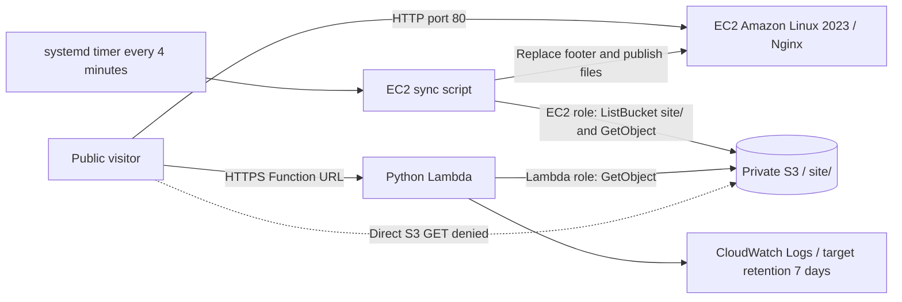

# Lab 7 — Host Your CV on AWS

Muhammad Arslan · **23L-3025** · iqbalarslan009@gmail.com

This project hosts my CV through an EC2 web server and a Python Lambda Function URL, with a private S3 bucket as the shared source. The portfolio HTML, responsive CSS and original CV PDF are preserved.

| Resource | Address or name |
| --- | --- |
| Repository | https://github.com/m-arslan009/Lab-7-CV-AWS-Hosting |
| EC2 website | http://54.252.152.179 |
| Lambda website | https://mxih5vg6yivpvbekwwnzgiyo7y0vhdqv.lambda-url.ap-southeast-2.on.aws/ |
| Region | `ap-southeast-2` (Sydney) |
| S3 bucket | `cv-23l-3025-82741` |
| EC2 instance Name tag | `cv-ec2-23l-3025` |
| EC2 role | `cv-ec2-role-23l-3025` |
| Lambda function | `cv-func-23l-3025` |
| Lambda role | `cv-lambda-role-23l-3025` |

## Verification status

Public endpoint checks were performed on **24 October 2026**. Both hosts returned HTTP 200 for `/`, `/index.html`, `/style.css` and `/cv.pdf`, with the expected HTML, CSS and PDF content types; Lambda `/anything` returned HTTP 404 with `text/html`. Anonymous direct S3 access returned HTTP 403 with `application/xml`. See `evidence.txt` for the original collector output and `endpoint-checks.txt` for the fresh public HTTP checks from this continuation.

The live EC2 footer was `Hosted on: EC2 i-0dd412efb83c5229b`, and the live Lambda footer was `Hosted on: Lambda cv-func-23l-3025`. Both downloaded PDFs matched the original local PDF byte for byte, and Lambda returned `Cache-Control: max-age=60`. The EC2 instance ID was observed in served HTML; matching it to the running AWS instance still needs authenticated verification.

Local validation passed Python syntax, all four JSON documents, all three Bash scripts, required files and size limits, embedded/standalone sync-script equality, and the collector's exact 11 headings and incorrect-argument behavior. Mocked Lambda checks passed for HTML/CSS/PDF routing, base64 round-trip, environment variables, unknown/traversal paths, retrieval failures and one JSON record per handled request. HTML/CSS/PDF SHA-256 hashes confirm the original site files are unchanged. Responsive rules were checked in the existing CSS; a browser-based mobile rendering check is still recommended.

**AWS configuration remains unverified:** AWS CLI is not installed in the preparation environment, so `evidence.txt` records real command-not-found errors for AWS queries. The IAM JSON files are **proposed least-privilege policies, not exports of the deployed roles**. The EC2 scripts and Lambda handler are reviewed local source; they have not been installed or deployed by this preparation task. No active AWS resource was changed.

Before final submission, run the collector in an authenticated AWS environment, replace the proposed policies with verified actual exports, and add the two EC2 output excerpts requested below. Successful HTTP responses alone do not prove S3 Block Public Access, versioning, IAM scope, runtime, memory, timeout, log retention, tags or budget settings.

## Architecture



An EC2 request reaches Nginx on port 80, which serves a local copy refreshed from private S3 using the instance role. A Lambda request reaches the public Function URL, whose handler retrieves the selected S3 object using the function role and builds the HTTP response.

## Repository

```text
README.md
collect-evidence.sh
evidence.txt
site/
  index.html
  style.css
  cv.pdf
ec2/
  user-data.sh
  sync-cv.sh
lambda/
  lambda_function.py
iam/
  ec2-trust.json
  ec2-permissions.json
  lambda-trust.json
  lambda-permissions.json
```

`collect-cloudshell.sh` performs authenticated collection and local IAM exports; `ec2/collect-instance-evidence.sh` collects timer/log/role-denial proof on the instance. `endpoint-checks.txt` contains the fresh real public HTTP results. `.gitignore` protects local credentials, private keys and generated packages; `.gitattributes` keeps shell scripts in LF format. The supplied assignment document is retained locally as a reference, outside the submission commit.

Technologies: Amazon S3, EC2, IAM, Lambda Function URLs, CloudWatch Logs, Amazon Linux 2023, Nginx, systemd, AWS CLI, Python/boto3, Bash, HTML/CSS, Git and curl.

## S3 and IAM

The required S3 state is all four Block Public Access settings enabled, versioning enabled, no bucket policy, and no public ACL grants. Exactly three current objects must exist: `site/index.html`, `site/style.css` and `site/cv.pdf`; retain `Hosted on: {{HOSTED_ON}}` in S3. The local HTML is 13,074 bytes and the PDF is 104,015 bytes, below even the decimal limits of 100 KB and 1 MB. Historical versions may exist because versioning is required.

`ec2-trust.json` trusts `ec2.amazonaws.com`; `lambda-trust.json` trusts `lambda.amazonaws.com`. The proposed EC2 inline permissions allow `s3:GetObject` on the three explicit site object ARNs and `s3:ListBucket` on the named bucket only when `s3:prefix` equals `site/`. Lambda has `s3:GetObject` on those same three explicit objects and no `s3:ListBucket`. Explicit object names avoid wildcard resources as required by Section 4 of the assignment; introducing another asset would require a reviewed policy change.

Lambda additionally requires the separate AWS managed policy `arn:aws:iam::aws:policy/service-role/AWSLambdaBasicExecutionRole`. That attachment is not part of `lambda-permissions.json`, which is the S3 inline policy. Its presence must be verified with `list-attached-role-policies`; it has not been assumed or applied here. There are no static AWS credentials in the submitted source.

Use `bash collect-cloudshell.sh` from an authenticated AWS CloudShell session to discover the real inline policy names and export both trust and permission policies. The helper retrieves and parses all four documents before replacing local drafts and keeps backups under ignored `.validation/backups/`. If retrieval fails or either role has zero/multiple inline policies, the four drafts remain in place and the actual policies are available in `evidence.txt` for review. Successful export also creates `iam/deployed-policy-metadata.json`, recording source roles, caller, managed attachments, original inline policy names and review findings. Noncompliant actual policies are reported and exported faithfully; no deployed role is modified. Until successful exports are reviewed, the four committed IAM files remain drafts.

## EC2 implementation and setup

`ec2/user-data.sh` is intended for a new Amazon Linux 2023 instance. It checks the operating system, installs Nginx, AWS CLI, Python and locking utilities, embeds the exact standalone sync script in `/opt/cv/sync-cv.sh`, and creates a systemd service and timer. It starts Nginx, enables the timer and starts the initial sync. The existing instance's user data has not been replaced.

The sync script uses temporary credentials supplied by the IAM instance role. It downloads `site/` into a temporary staging directory, retrieves the real instance ID through an IMDSv2 token, validates all three files, and replaces the placeholder with `EC2 <instance-id>`. Each file is published with an atomic rename after downloads succeed; HTML is published last. Staging afresh also prevents a previously substituted footer from defeating later synchronization. The script writes a UTC timestamp and `SUCCESS` or `FAILED` to `/var/log/cv-sync.log` and uses a lock to prevent concurrent runs.

The timer starts the service every four minutes; the service has a 50-second timeout, leaving headroom within the five-minute update requirement during successful operation. Network or permission failures can delay updates and are recorded as failures; the next timer run retries. Nginx's standard MIME configuration serves HTML, CSS and PDF.

For a reviewed future deployment, use one eligible `t2.micro` or `t3.micro` Amazon Linux 2023 instance, attach the instance profile containing the EC2 role, require IMDSv2 (`HttpTokens=required`), and use its ordinary public IPv4 address. Permit inbound TCP 80 from anywhere; TCP 22 must be absent or restricted to your own single `/32`; allow no other inbound rules. Do not allocate an Elastic IP, NAT gateway or load balancer. Use `Owner=23l-3025` and `Course=cloud` tags on the instance, bucket, function and both roles. Check your account's actual Free Tier/credits and budget in Billing.

Read-only checks from a shell on the existing instance:

```bash
cat /etc/os-release
systemctl status nginx cv-sync.timer --no-pager
systemctl cat cv-sync.service cv-sync.timer
sudo tail -n 10 /var/log/cv-sync.log
```

## Lambda implementation and setup

Handler: `lambda_function.lambda_handler`. `BUCKET` and `PREFIX` are required environment variables; configure them as `cv-23l-3025-82741` and `site/`. The handler does not hard-code the bucket or prefix. Use the latest Python runtime offered for this Region, 128–256 MB memory, a 10-second timeout, and seven-day retention on `/aws/lambda/cv-func-23l-3025`; the actual values require AWS verification.

`/` and `/index.html` return HTML with the footer `Hosted on: Lambda cv-func-23l-3025` and `Cache-Control: max-age=60`. `/style.css` returns CSS; `/cv.pdf` returns a base64 body with `isBase64Encoded=true` and `Content-Type: application/pdf`. Unknown paths return a short HTML page with status 404 without accessing S3. Internal retrieval failures return a generic error; known missing objects return 404, but S3 can conceal a missing object as AccessDenied when the role lacks ListBucket. Each handled request prints one JSON record with `fn`, `path`, `status` and elapsed `ms`; Lambda platform lifecycle logs are separate.

Use Function URL authentication `NONE` and verify the function resource policy grants public URL invocation. Current AWS guidance requires both `lambda:InvokeFunctionUrl` and `lambda:InvokeFunction`, with conditions restricting this permission to the Function URL. These invocation permissions are distinct from the execution role's private S3 access. No function code, environment, URL policy or log group was modified here.

For a future approved code deployment, package `lambda/lambda_function.py` at the root of the ZIP, choose the handler above, review the current configuration, and deploy through your existing Lambda function. Preserve the known working deployment until its configuration and source have been exported and compared. Likewise, review S3 changes before uploading: the EC2 timer automatically publishes them.

## Testing and evidence collection

Run this from a Bash shell with AWS CLI and curl available, preferably AWS CloudShell in Sydney or an approved authenticated CLI session. Use temporary/session credentials with the required read permissions; never put credentials in this repository.

```bash
bash collect-evidence.sh cv-23l-3025-82741 \
  http://54.252.152.179 \
  https://mxih5vg6yivpvbekwwnzgiyo7y0vhdqv.lambda-url.ap-southeast-2.on.aws/
```

With AWS CLI and curl available, the collector writes `evidence.txt`, records command failures, continues through exactly 11 named sections, and prints `DONE`. If AWS CLI or curl is absent, it exits 127 before touching existing evidence and gives CloudShell instructions. Authentication or individual AWS command failures are recorded during collection; `DONE` means collection finished, not that AWS configuration passed. `NoSuchBucketPolicy` is explicitly marked expected; AccessDenied and other errors remain unexpected. Account-dependent checks are skipped if account discovery fails, and Lambda tags use the actual function ARN rather than a constructed account placeholder. With two arguments it prints usage and exits 1. Re-run it in your AWS environment and commit the resulting genuine output, replacing this preparation run with its missing-CLI errors. The script is specific to this lab's named roles, function and instance; its three arguments select the bucket and public addresses. Additional C15 read-only checks inspect instance counts, IP allocations, NAT gateways, load balancers and budget existence in the configured Region.

Useful local validation commands:

```bash
python -c "import ast,pathlib; ast.parse(pathlib.Path('lambda/lambda_function.py').read_text())"
bash -n collect-evidence.sh
bash -n ec2/user-data.sh
bash -n ec2/sync-cv.sh
bash -n collect-cloudshell.sh
bash -n ec2/collect-instance-evidence.sh
python -m json.tool iam/ec2-trust.json > /dev/null
python -m json.tool iam/ec2-permissions.json > /dev/null
python -m json.tool iam/lambda-trust.json > /dev/null
python -m json.tool iam/lambda-permissions.json > /dev/null
```

### Required EC2 access-denied excerpt

**Pending: no instance shell or authenticated AWS access was available.** Run `ec2/collect-instance-evidence.sh` on the existing instance as described below, then paste its actual deletion command and AccessDenied output here. The helper uses the instance role, a random nonexistent test key and an explicit null version; it never targets a CV object. Anonymous S3 HTTP 403 is a separate check and cannot replace instance-role denial evidence. No deletion probe was run during local preparation.

### Required final ten EC2 synchronization log entries

**Pending: retrieve the actual entries with `sudo tail -n 10 /var/log/cv-sync.log` on the instance and paste them here.** Confirm at least three consecutive scheduled runs. No sample log lines are presented as evidence.

## Section 8 written answers

### 1. Why roles instead of access keys, and what if keys were in user data?

Roles supply temporary credentials that AWS rotates, with permissions scoped to the workload. Long-lived keys in user data could be exposed through instance configuration, copied scripts or logs. Anyone obtaining them could use their permissions until they were revoked, potentially outside the intended instance or function.

### 2. What happens when someone opens the direct S3 address?

The anonymous browser request receives HTTP 403 AccessDenied, which was observed in the public endpoint check. The intended configuration keeps all four Block Public Access settings enabled and grants no public bucket-policy or ACL access. Private role grants let the two workloads read the objects without making them public. HTTP 403 alone does not prove that every required bucket setting is configured correctly.

### 3. Why is public Function URL permission acceptable?

With authentication `NONE`, the function resource policy permits anonymous URL invocation using the required invocation actions, restricted to that function and URL context. The execution role separately limits which S3 objects the function can read. Public invocation is appropriate because the handler intentionally publishes only the CV routes. Public bucket access would bypass that routing and response logic and violate the private-source requirement.

### 4. What costs remain at idle, and what happens with 100 times the traffic?

A running EC2 instance has compute costs even without visitors, with storage and public IPv4 charges also potentially applying after credits or allowances. On-demand Lambda normally has no request/compute charges when it is not invoked, although S3 storage, stored logs and other applicable services still cost money. At 100 times the traffic, the single EC2 instance may become a bottleneck, while Lambda scales subject to concurrency, throttling and downstream limits. Lambda request/duration, S3 reads and transfer charges can increase with traffic, so the actual account budget and pricing must be checked.

### 5. What remains if the EC2 instance is deleted?

The instance's running web server, local sync state and ordinary public IPv4 endpoint are lost; attached volumes are deleted or retained according to their deletion settings. S3 objects and versions, the Lambda hosting path, repository and separate IAM roles remain unless explicitly deleted. Any retained volumes or other resources may continue to incur charges. The EC2 path can be rebuilt from the retained source and configuration after approval.

## Finish evidence collection from AWS CloudShell

AWS CLI and local AWS credential/profile files were not available during this continuation. Both `aws --version` and `aws sts get-caller-identity` could not execute locally. The existing genuine `evidence.txt` has been preserved; its missing-CLI failures are historical evidence of an incomplete run, not authenticated AWS configuration. The new collector's missing-CLI guard prevents producing another misleading run.

Open AWS CloudShell in **ap-southeast-2** using your existing signed-in AWS account. In a fresh CloudShell directory, run exactly:

```bash
git clone https://github.com/m-arslan009/Lab-7-CV-AWS-Hosting.git
cd Lab-7-CV-AWS-Hosting
bash collect-cloudshell.sh
```

If the clone already exists in CloudShell, enter it and run `git pull --ff-only` before the helper. CloudShell includes AWS CLI and uses your session; do not enter or share access keys. If an AWS query is denied, use the correct existing account/session or obtain the necessary read permission; do not broaden either workload role for collection.

Review the eleven sections in `evidence.txt`: four public-access settings must be true, versioning Enabled, exactly the three required current keys with acceptable sizes, correct least-privilege role policies, required security-group/IMDS/instance settings, endpoint responses, request JSON logs and seven-day retention. Check Lambda's supported Python runtime, 128–256 MB memory, 10-second timeout, BUCKET/PREFIX values, execution role, Function URL AuthType NONE and public invocation policy. The helper collects these values but its completion does not certify them. Review tags, budget and C15 resources too. No such authenticated values have yet been verified locally.

### Collect the existing instance evidence

From a Bash shell containing the clone and your existing SSH key (never add that key to Git), run:

```bash
ssh -i /path/to/existing-key.pem ec2-user@54.252.152.179 \
  'bash -s' < ec2/collect-instance-evidence.sh > ec2-instance-evidence.txt
```

Replace only the key path. Use SSH only if your current security group already permits your address; otherwise use your existing EC2 Instance Connect session and paste/run the helper there. No security-group change is needed for repository preparation. The helper collects OS/instance identity, actual systemd timer units/status, the last ten synchronization log entries, caller identity and the actual S3 denial test. It clears other credential providers and refuses the probe unless the caller ARN is the expected EC2 role. It does not retrieve or print instance credential JSON or metadata tokens.

The probe targets a fresh random `site/.readonly-probe-<uuid>` key with `--version-id null`. Explicit version deletion avoids adding a delete marker in the versioned bucket, and no real CV key is targeted even if permissions are unexpectedly excessive. Only an actual AccessDenied result counts; a successful response or different error is an unresolved permission/test issue. Do not retry against a real CV file. This probe establishes denial for the probe resource; review the full IAM policy as well to rule out per-object write grants.

Paste the genuine AccessDenied excerpt and ten sync log lines into their pending README sections. Check at least three consecutive SUCCESS entries and their timestamps against the actual timer configuration (interval no greater than five minutes); neither a source-code timer nor the public footer proves the running timer. The live instance ID must match authenticated `describe-instances` output. Keep all remaining gaps marked pending until their evidence is obtained.

After reviewing actual outputs and scanning for credentials/private keys, commit from your authenticated GitHub environment:

```bash
git diff --check
git diff -- README.md evidence.txt iam/
git add README.md evidence.txt iam/
# If desired, include the reviewed raw instance output separately:
# git add ec2-instance-evidence.txt
git commit -m "Add authenticated AWS policies and final instance evidence"
git push origin main
```

The five Section 8 answers above are preserved. No AWS resources, deployed source, timer, IAM permissions or retention settings are changed by the collection workflow.

## Submission checklist

- Refresh `evidence.txt` using AWS CLI and replace the proposed IAM JSON with verified deployed policies; confirm all C7–C10 and C13 requirements.
- Paste the actual instance-role AccessDenied output and last ten sync log lines above.
- Verify runtime, 128–256 MB memory, 10-second timeout, seven-day retention, tags on all five required resources, account budget and C15 resource hygiene.
- Check both public sites, footers, PDF rendering and mobile layout immediately before submission; keep both endpoints working until marking ends.
- Review staged content for secrets/private keys, then commit and push to `main` with an account authorized to write this existing repository.
- Submit the repository URL, both website URLs and roll number `23L-3025` through the instructor's channel.

## References and authorship

The existing portfolio and CV were retained. Repository preparation, the proposed Lambda handler, revised synchronization code, proposed policies and evidence collector were prepared with Codex assistance; review them and be able to explain them before submission, and confirm the instructor's AI-tool policy (the provided assignment leaves it unspecified).

Collector regression checks passed using isolated fixtures for wrong arguments, missing CLI, expected NoSuchBucketPolicy, actual-error classification, authentication failure, account/resource discovery, multiple policy names/security groups, all eleven headings and DONE. These fixtures are local tests and are not committed as AWS evidence. Fresh public HTTP checks passed; the authenticated configuration and instance excerpts remain pending.

Collection references: [AWS CloudShell](https://docs.aws.amazon.com/cloudshell/latest/userguide/welcome.html), [bucket Region discovery](https://docs.aws.amazon.com/cli/latest/reference/s3api/get-bucket-location.html), and [version-specific S3 deletion](https://docs.aws.amazon.com/AmazonS3/latest/API/API_DeleteObject.html).

Adapted using official AWS documentation: [Function URL request/response format](https://docs.aws.amazon.com/lambda/latest/dg/urls-invocation.html), [Function URL access control](https://docs.aws.amazon.com/lambda/latest/dg/urls-auth.html), [S3 IAM resource and action scoping](https://docs.aws.amazon.com/AmazonS3/latest/userguide/security_iam_service-with-iam.html), and [Lambda runtimes](https://docs.aws.amazon.com/lambda/latest/dg/lambda-runtimes.html). Cost discussion follows [EC2 On-Demand pricing](https://aws.amazon.com/ec2/pricing/on-demand/) and [Lambda pricing](https://aws.amazon.com/lambda/pricing/); no fixed prices or Free Tier eligibility are assumed for this account.
